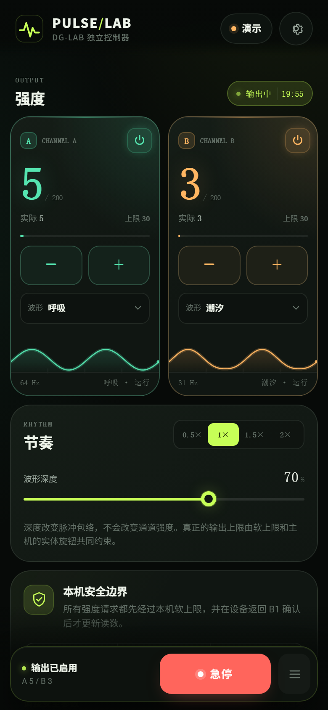

# PULSE/LAB

**面向 Android 的第三方 DG-LAB Coyote V3 蓝牙控制器，带 Phira 漏接触发模式。** 同时提供**可安装 APK**（原生 BLE + 屏幕识别）和 **Android Chrome PWA**（Web Bluetooth）。无后端、无账号、无云端中转。

> **非官方项目。** 与 DG-LAB / 郊狼官方无任何关联。蓝牙控制存在延迟和断连风险，软件保护不能替代你的判断。仅限自愿的成年人使用；请从最低强度开始。



## 功能

- **Coyote V3 直连**：Service `180C`，写入 `150A`，通知 `150B`，电量 `180A/1500`。
- **双通道独立控制**：A / B 各自的强度、软上限、波形与波形开关。
- **10 Hz 波形引擎**：8 种本地波形（呼吸、潮汐、心跳、连击、涟漪、阶梯、随机、恒定），每帧 4 个 25 ms 采样。
- **安全锁**：默认锁定；必须长按 1 秒才能启用，启用时先写入绝对 0 强度。
- **强度回执**：只允许一个强度请求在途，收到相同序列号的 B1 回执后才继续；超时会自动急停归零。
- **软上限**：连接后自动写入 BF；同时在本机拦截所有强度请求。默认 A/B = 30。
- **急停归零**：急停后反复发送绝对 0 强度并等待回执，同时停止波形数据。
- **会话保护**：切后台/锁屏自动急停、默认 20 分钟自动停止、屏幕常亮。
- **专家参数**：两通道的频率平衡参数 1 / 2。
- **APK**：本地 Web UI + 原生 Android BLE 桥，离线可用，不需要服务器或浏览器。
- **Phira 联动（1.1.1 新增修复）**：同一 APK 的第二个桌面图标。录屏识别 Phira 画面里的 `COMBO` 字样；连击断开（Bad / Miss）时发一次短脉冲。需手动点悬浮窗「开始」才武装，支持暂停、急停、通知栏开始/暂停、把悬浮窗隐藏成一个小 P 按钮，以及 20 分钟自动停止。
- **双入口任务修复（1.1.1）**：PULSE/LAB 与 Phira 模式改用独立任务栈，避免 Phira 在前台时点 PULSE/LAB 只把旧任务拉回来；通知栏新增「打开控制器」。
- **PWA**：可安装到主屏幕，壳资源离线缓存；蓝牙本身为本地连接。
- **演示模式**：不连接硬件也能完整体验启用、步进、回执、软上限和急停流程。

## Android APK

已构建可侧载安装包：

**[dist/PULSE-LAB-1.1.4.apk](dist/PULSE-LAB-1.1.4.apk)**（约 **43.7 MiB**）

SHA-256：`e7d0dc04fd9b9014a145e76e466e4ac4308113fe3f45d26d7233c78797bc575c`

- 包名 `com.pulselab.controller`，版本 `1.1.4`（versionCode 6），最低 Android 8.0（API 26），目标 SDK 35。
- **1.1.4 计数分离**：**断连击次数**只要 OCR 看到 COMBO 消失就 +1，不需要连接 Coyote；**触发次数**只有 BLE 实际发送脉冲才 +1。这样不接主机也能验证识别是否工作。
- **1.1.3 诊断增强**：Phira 模式页新增「测试一次脉冲（不记录 Miss）」；悬浮窗按钮显示 `暂停 ✓`（OCR 已识别到连击）或 `暂停 …`（未识别到）；`adb logcat -s PulseLabPhira:D` 会输出节流后的 OCR 文本。
- **1.1.2 修复**：把 `getWindow().getInsetsController()` 移到 `setContentView()` 之后并加异常保护，修复部分 ROM/虚拟机启动 PULSE/LAB 时的 `DecorView ... null` 崩溃。
- **1.1.1 修复**：两个启动入口使用独立任务栈；Phira 模式的通知栏增加「打开控制器」；悬浮窗可隐藏成小 P 按钮。
- 这是**控制器 + Phira 联动**合并包；安装后桌面会出现 **PULSE/LAB** 和 **Phira 联动** 两个图标，二者是同一个 APK、同一个签名，**不能同时连接同一个 Coyote**。
- 体积从 1.0.0 的约 300 KB 增加到约 44 MB，主要是内置的离线 ML Kit OCR 模型（支持 arm64-v8a / armeabi-v7a / x86 / x86_64）。
- `dist/` 默认是构建产物目录（见 `.gitignore`）；从源码克隆时请按下面的命令重新构建，或使用 Release 附件。
- **APK 内置本地 Web UI、原生 Android BLE 桥、屏幕捕获前台服务和离线 OCR**，不需要 HTTPS、浏览器、网络或电脑；Phira 模式只在本机处理画面，不上传。
- 安装/更新：传到手机后点开安装（允许「安装未知应用」），或：

```powershell
adb install -r dist\PULSE-LAB-1.1.4.apk
```

- 控制器模式首次点击「连接设备」时授予 **附近的设备** 权限。Android 11 及以下还需要定位权限/定位服务用于 BLE 扫描。
- Phira 模式还需要 **悬浮窗权限**、**通知权限** 和一次系统屏幕捕获授权。所有权限都在对应的模式内单独申请。
- 文件旁边有 `.sha256` 校验值。签名者为本地 debug 证书（`CN=PULSE/LAB Debug`，SHA-256 证书指纹 `18f9dd3a…d6b1ff`）；应用本身是 release 构建（不可调试），仅用于侧载。若要上架/公开分发，请用自己的 release keystore 重新签名。
- **APK 已编译、v2 签名验证、zipalign 对齐，Web UI 与原生桥接的自动化测试通过；但当前环境没有实体 Android 手机、实体 Coyote V3，也没有安装 Phira 实测 OCR。** 首次使用请从最低强度开始，先确认连接、回执、急停和软上限正常。
- **1.0.0 / 1.1.0 / 1.1.1 / 1.1.2 / 1.1.3 仍保留在 `dist/` 和仓库根目录备查。** 由于使用同一签名和包名，可以直接用 1.1.4 覆盖安装旧版。

更新 APK 请保留 `android/keystore/pulselab-debug.keystore`（口令 `android`），否则 Android 会把新包当成不同签名的应用，需要先卸载。

## Phira 联动（APK 第二个图标）

> **只支持官方单机 Phira 的画面识别。** 官方单机版不向其他 App 提供实时判定接口，界面也没有逐音符的 “Miss” 文字。这个模式检测的是 Phira 顶部 `COMBO` / `AUTOPLAY` 字样：**Combo 消失（Bad 或 Miss 造成断连击）时触发**，不是严格区分 Bad/Miss。

### 使用步骤

1. 安装 1.1.4 APK，桌面点 **Phira 联动**（不要先打开 PULSE/LAB 控制器并连接设备）。
2. 授予 **附近的设备**、**通知** 权限；点「授予悬浮窗权限」并在系统设置中允许。
3. 设置 **触发强度**（默认 15，最大 60）、**持续时间**（默认 0.8 秒）和 **冷却**（默认 2 秒）；触发通道选 A / B / A+B。
4. 勾选风险确认，点 **开始录屏监听**，同意系统屏幕捕获。此时只完成了屏幕捕获和 Coyote 扫描，**还没有开始检测**。
5. 按 Home 键打开 Phira（横屏），进入歌曲；在准备打歌时点左下角悬浮窗的 **开始**。点之前不会检测、不会触发。通知里也有「开始检测 / 暂停检测」，悬浮窗万一被系统拦截时可用。
6. 连击断开时发一次短脉冲；悬浮窗 **暂停** 会立刻结束当前脉冲，**停止** 会归零并断开蓝牙。也可以从通知里的「停止并归零」操作。开始检测后悬浮窗会收起文字；点 **隐藏** 后会缩成一个小 **P** 按钮，点 P 恢复。通知栏还有 **打开控制器**。
7. 一首歌结束后建议立刻点暂停/停止。歌曲结束、暂停菜单、切歌和识别失败都可能造成一次误触发。

### 检测原理与边界

- 屏幕捕获缩小到半分辨率后，把 **完整画面** 缩放后送入 **离线 ML Kit 拉丁文字识别**；检测 `COMBO` 或 `AUTOPLAY`。不依赖固定的顶部裁剪框，横屏/反向横屏都能工作。
- 连续两次识别到标签后才会武装；标签消失即触发，并进入冷却；标签重新出现后再武装。
- **前 3 个 Combo 之前不会显示标签**，所以前三个音符的 Miss 检测不到。
- 高密度谱面中 Combo 可能在两次 OCR 之间短暂消失又出现，可能漏检；认字失败或暂停/结算画面可能误触发。
- Phira 模式固定为**横屏**；如果 Phira 被设置成竖屏，画面比例/方向可能对不上，识别会失败。
- 自定义皮肤、修改 UI、把 Combo 文字隐藏、系统字体/缩放异常，都可能导致识别失败。当前版本用默认 Phira UI 最稳。
- 首次使用建议先在低强度下打一首慢歌，观察悬浮窗状态和触发次数，再逐步调整强度；**不要直接上高强度**。

### 安全与连接

- Coyote 的 BLE 同一时间只能被一个 App 连接。Phira 模式会独立扫描并连接主机；如果 PULSE/LAB 控制器仍连接着设备，Phira 模式会连接失败。
- 反之，一旦重新打开 PULSE/LAB 控制器，Phira 监听会被自动停止。**两个模式互斥。**
- Phira 模式连接后会写入 BF 软上限，上限值 = 本次设置的触发强度，因此主机旋钮会被限制在该值以内；需要恢复更高范围时，在控制器/官方 App 重新连接并写入软上限。
- 触发只从 0 开始短时增强，结束后归零；不会叠加、不会自动递增。触发需要设备的 B1 强度回执；1.5 秒内没有回执会停止并断开。
- 悬浮窗/通知的停止按钮会归零并断开；屏幕捕获被系统结束时也会停止。
- **首次真机测试请空载或最低强度，并准备随时关闭主机电源。** 软件停止不能替代物理断电。

### 从源码构建 APK

1.1.x 起 APK 使用 **Gradle + Android Gradle Plugin + 离线 ML Kit**，不再使用手写 `javac`/`d8` 脚本。要求：

- Windows PowerShell 5.1+
- JDK 17（`JAVA_HOME`）
- Android SDK：`platforms;android-35`、`build-tools;35.0.0`
- 首次构建需要网络下载 Gradle 依赖与 ML Kit；之后可离线构建（依赖已缓存）

```powershell
cd android
$env:JAVA_HOME = "C:\path\to\jdk-17"
$env:ANDROID_HOME = "C:\path\to\Android\Sdk"

# 首次可让 Gradle 下载 wrapper 与依赖
.\gradlew.bat :assembleRelease

# 产物
# android\build\outputs\apk\release\PulseLab-release.apk
```

也可以用仓库脚本（会同时写入 `android/local.properties` 并复制/计算 SHA-256）：

```powershell
powershell -ExecutionPolicy Bypass -File .\scripts\build-apk.ps1 `
  -JdkHome "C:\path\to\jdk-17" `
  -AndroidSdk "C:\path\to\Android\Sdk"
```

产物默认写入 `dist/PULSE-LAB-1.1.4.apk`。Android 源码在 `android/src/`，Web 资源在构建前由 `syncWebAssets` 从仓库根目录同步到 `android/assets/www`。

- 版本号在 `android/build.gradle` 的 `versionCode` / `versionName` 中维护。
- 签名使用 `android/keystore/pulselab-debug.keystore`（口令 `android`）；公开分发前请替换为你自己的 release keystore。
- ML Kit OCR 依赖为 `com.google.mlkit:text-recognition:16.0.1`（bundled，离线模型）。
- 若修改 `sw.js` 的缓存内容，记得递增 `CACHE_NAME`；Phira 模式是原生代码，不需要 Service Worker。

## Web / PWA 使用

### 前置条件

- Android 手机，使用 **Chrome**（推荐最新版；Edge 也可）。
- 手机支持蓝牙，Coyote V3 主机已开机。
- 页面必须运行在 **HTTPS** 或 `localhost`。这是 Web Bluetooth 的安全要求。
- 不要在微信、QQ、小红书、系统浏览器或普通 WebView 里打开——它们通常没有 `navigator.bluetooth`。

### 方式一：Netlify Drop（最简单，无需一直开电脑）

1. 打开 <https://app.netlify.com/drop>。
2. 只上传 Web 运行文件：`index.html`、`app.css`、`manifest.webmanifest`、`sw.js`、`js/`、`assets/`。**不要上传 `android/`、`dist/`、`tests/`、`scripts/`**，尤其不要公开 `android/keystore/`。
3. 等待生成一个 `https://….netlify.app` 地址。
4. 用 Android Chrome 打开该地址。
5. Chrome 菜单 → **安装应用 / 添加到主屏幕**。
6. 点「连接设备」，在系统蓝牙选择器中选择 **`47L121000`**（Coyote V3 主机；`47L120100` 是无线传感器，不适配本控制器）。

### 方式二：GitHub Pages

仓库已包含 Pages 部署工作流 `.github/workflows/pages.yml`：

1. 将项目 push 到 GitHub 的 `main` 分支。
2. 仓库 **Settings → Pages → Build and deployment → Source** 选择 **GitHub Actions**。
3. 等待 Actions 完成，在 `https://<用户名>.github.io/<仓库名>/` 打开。
4. Android Chrome 打开并按菜单安装到主屏幕。

项目全部使用相对路径，放在子路径下也能正常工作。

### 方式三：本地 USB 调试（不需要公网）

localhost 被视为安全上下文，适合在有线连接下测试：

```powershell
# 电脑上启动静态服务器
python serve.py

# 手机用 USB 连接电脑并开启 USB 调试后
adb reverse tcp:8787 tcp:8787
```

然后在手机 Chrome 打开 `http://127.0.0.1:8787/`。

Windows 也可以双击 `start.bat` 启动服务器，再执行上面的 `adb reverse`。**不要用 `http://192.168.x.x` 访问**——局域网 HTTP 不是安全上下文，Chrome 不会开放蓝牙。

## 连接与操作

1. 主机开机，确保没有其他手机/App 占着它。
2. 点「连接设备」，在系统选择器里选 `47L121000`。
3. 连接成功后，App 写入 BF 软上限，默认进入安全锁。
4. **长按底部「按住 1 秒启用」**。启用时 App 先发绝对 0 强度；若已知强度不为 0，会等待 B1 归零回执。
5. 用每个通道下方的 `−` / `+` 调整强度。单击 ±1；按住会加速。
6. 用通道卡片里的下拉框切换波形；下方「节奏」控制播放速度和波形深度。
7. 任何时候点红色 **急停**，或按浏览器返回/切后台（默认开启）来停止。

### 使用禁忌

- 仅限自愿的成年人使用；确保参与者随时可以叫停，并事先约定安全词。
- **不要将电极置于头部、胸部或跨越心脏的位置**；不要同时让电流经过心脏路径。
- 有心脏起搏器、胰岛素泵或其他植入式电子设备，孕期，癫痫，皮肤破损/炎症，或对电刺激敏感时，请勿使用。
- 不要在驾驶、操作机械、洗浴、游泳、睡眠或无人看护时使用；不要在充电时使用。
- 只使用设备原厂或明确兼容的电极与线材，并确保电极完整贴合、没有短路。
- 任何时候感到疼痛、灼热、头晕或不适，立即急停并关闭主机电源。软件急停不能替代物理断电。

### 安全设计

- **强度只按绝对值设置**，每次改动都受本机软上限约束。
- **一个请求在途**：改动强度后等待设备 B1 回执，超时（1.6 秒）自动急停。
- **启用门槛**：长按 1 秒 + 归零窗口。若已知设备强度非 0，必须收到归零回执才允许启用；设备本来就在 0 时可能不会因为「设为 0」产生强度变化通知，此时先写入归零指令，再以已知 0 强度启用。
- **急停**：在 4.2 秒窗口内反复发绝对 0，并在界面锁定；若收不到归零回执，会明确提示你关闭主机电源检查。
- **写失败即断开**：一旦 GATT 写入失败，不再继续发送波形，直接断开并提示确认主机状态，避免在未知状态下继续控制。
- **切后台急停**：浏览器由 `visibilitychange` 触发；APK 还会在 Activity 进入后台时主动通知页面急停。默认开启，可在设置里关闭，但不推荐。
- **自动停止**：默认 20 分钟，可调整为 10 / 20 / 30 / 45 分钟或关闭。
- **屏幕常亮**：启用后通过 Screen Wake Lock 尽量保持屏幕点亮。

这些措施只能降低风险，不能保证在所有 Android 设备、所有蓝牙链路状态下生效。**首次实机测试请空载或最低强度，并准备随时关闭主机电源。**

## 实机与测试状态

- 协议层、波形引擎、BF/B0/B1 编解码、软上限、模拟设备、Web Bluetooth 适配器、Android 原生桥接的 JS 传输层都有自动化测试；`node --test` 共 **39 项通过**。
- UI 在 320 / 360 / 390 px 宽度下通过无头 Chromium 测试，并用本地模拟器走通「连接 → 长按启用 → 加/减强度 → B1 回执 → 急停归零 → 修改软上限」。
- 1.1.4 APK 通过 Gradle/AGP 构建，`aapt2 dump badging` 确认版本/两个启动入口/独立任务栈/权限/服务，`apksigner` v2 验签通过，`zipalign` 对齐通过；APK 内已确认包含 Phira 模式、悬浮窗隐藏、「打开控制器」、测试脉冲、OCR 日志和断连击独立计数的最新 dex 字符串、离线 ML Kit 原生库和 Web 资源。
- **启动崩溃修复已针对真机日志中的 `MainActivity.onCreate:89` NPE 定位并改到 `setContentView()` 之后；仍建议安装后先确认控制器能打开。**
- **当前环境没有实体 Android 手机、实体 Coyote V3，也没有安装 Phira 实测 OCR，因此未做真机安装、真机蓝牙或真实 Phira 画面验证。** Phira 模式的核心风险是 OCR 对真实字体/皮肤/分辨率的表现；首次使用务必低强度、先测试悬浮窗开始/暂停/停止。
- **Phira 模式不修改 Phira，也不读取游戏内存。** 它捕获屏幕画面，在本机用 ML Kit 识别；没有网络上传。

## 协议说明

实现依据：[DG-LAB Bluetooth Protocol — Coyote V3](https://github.com/dungeonlab-open/dglab-bluetooth-protocol/blob/main/coyote/v3/README.md)。

| 项目 | 值 |
| --- | --- |
| 设备名 | `47L121000`（主机） |
| 控制服务 | `0000180c-0000-1000-8000-00805f9b34fb` |
| 写入特征 | `0000150a-0000-1000-8000-00805f9b34fb` |
| 通知特征 | `0000150b-0000-1000-8000-00805f9b34fb` |
| 电量 | `0000180a-…` / `00001500-…` |
| 帧周期 | 100 ms，每帧每通道 4 × 25 ms |
| 频率映射 | 10–1000 Hz → 10–240 |
| 强度范围 | 0–200 |
| 波形强度 | 0–100 |

- **B0（20 字节）**：同时发送两通道强度模式、设定值和 4×2 波形采样。序列号非 0 时等待 B1 回执。
- **BF（7 字节）**：A/B 软上限 + 频率平衡参数 ×2 + 强度平衡参数 ×2。连接后必定重写；参数会掉电保存。
- **B1**：`B1 + 序列号 + A 实际强度 + B 实际强度`。
- 平衡参数默认 **128**（0–255）。该默认值是本 App 的选择，不是协议规定的官方默认；可在「设置 → 专家参数」中调整。

## 本地开发

无需安装前端依赖：

```powershell
python serve.py --open    # http://127.0.0.1:8787
```

运行测试（Node.js 20+）：

```powershell
node --test
node --check js/app.js
node --check js/ble.js
node --check js/protocol.js
node --check js/patterns.js
node --check js/waveform-view.js
```

### 文件结构

```text
index.html                 单页应用结构
app.css                    移动优先的界面样式
manifest.webmanifest       PWA 清单
sw.js                      Service Worker / 离线壳
js/protocol.js             V3 B0 / BF / B1 编解码
js/patterns.js             8 种波形与 25 ms 采样
js/ble.js                  Web Bluetooth / 原生桥 / 模拟器传输
js/waveform-view.js        Canvas 波形显示
js/app.js                  界面、安全状态机、连接生命周期
android/                   APK 工程（Gradle）
  build.gradle             版本、签名、ML Kit、Web 资源同步
  AndroidManifest.xml      两个启动入口、前台录制/蓝牙服务、权限
  src/.../MainActivity.java      WebView、本地资产服务、生命周期
  src/.../CoyoteBleBridge.java   原生 Android BLE 桥（控制器模式）
  src/.../PhiraActivity.java     Phira 模式设置与权限
  src/.../PhiraMonitorService.java 屏幕捕获、悬浮窗、OCR、触发状态机
  src/.../PhiraBleController.java  精简的 Coyote BLE 触发控制
  res/                          图标、主题、字符串、Phira 布局
  keystore/                     侧载签名密钥（更新 APK 时保留）
tests/                     协议、波形、传输、静态结构测试
scripts/build-apk.ps1      Gradle 构建/复制/签名产物
scripts/make_*.py          图标生成
serve.py                   零依赖本地 HTTP 服务器
dist/                      APK 产物（加入 .gitignore，交付时单独提供）
.github/workflows/pages.yml GitHub Pages 部署
```

### 修改后的更新

Service Worker 是 cache-first。修改应用文件后，把 `sw.js` 里的 `CACHE_NAME` 版本号递增（例如 `pulselab-shell-v1.0.1`），否则已安装的旧版本可能继续使用缓存。Chrome DevTools → Application → Service Workers → Update 可强制刷新。

## 常见问题

**APK 安装被 Play Protect / 系统拦截**

- 这是侧载的 debug 证书签名包，不是 Play Store 应用。允许「安装未知应用」后重试；若仍被拦截，可临时关闭 Play Protect 扫描或使用 `adb install`。
- 不要从第三方渠道下载二次修改的 APK；核对 `.sha256`。

**APK 搜索不到设备 / 没弹权限**

- 确认已授予「附近的设备」（Android 12+）或定位权限（Android 11 及以下）。
- 主机没有被其他手机或官方 App 占用；关闭再打开主机蓝牙。
- 如系统有蓝牙扫描限制，打开一次定位服务后再重试。
- 真机问题可抓日志：`adb logcat -s PulseLabBLE`。

**「连接设备」按钮是灰的 / 没有蓝牙选择器（Web 版）**

- 必须用 Android Chrome，且页面为 HTTPS 或 localhost。
- 内置浏览器、微信等不支持 Web Bluetooth；请用 Chrome 打开链接，或改用 APK。
- 如果页面地址是 `http://` 局域网 IP，请改用 HTTPS 部署或 `adb reverse` 的 localhost。

**蓝牙选择器里看不到设备**

- 主机已开机，蓝牙未被其他手机连接；关闭官方 App 后重试。
- Android 设置里打开蓝牙；部分机型需要打开定位服务后 BLE 扫描才返回结果。
- 设备名以 `47L` 开头，主机为 `47L121000`。不要选无线传感器。
- 重启主机蓝牙/电源，再刷新页面重试。

**连接上了，但长按后显示「未确认设备归零，未启用输出」**

- 说明 App 已知设备强度不为 0，却没有收到归零回执。可能是链路不稳定或设备忙。
- 先关闭主机电源再重开，确认没有其他控制端连接，然后重试。
- 如果反复出现，请立即停止并检查设备。

**启用后强度不动 / 一直没有 B1**

- App 会在 1.6 秒超时后自动急停。检查信号距离、是否被其他设备占用，重新连接。
- 真机首次使用建议保持手机靠近主机（1–3 米内）。

**切到别的 App 就停了？**

控制器模式默认会在切到后台时自动急停。若要关闭，设置 → 会话保护 → 关闭「切到后台时急停」；但不建议在穿戴/高强度场景关闭。
Phira 模式是例外：它由前台服务运行，切到 Phira 后会继续，但必须先在悬浮窗点「开始」；点「暂停/停止」或打开控制器才会结束。

**Phira 模式一直不触发**

先分清“没有输出”和“没有检测到”。1.1.4 把两个数字分开了：

- **断连击 N 次**：OCR 看到 COMBO 消失就计数，**不需要连接 Coyote**。
- **触发 N 次**：只有 BLE 真的发出脉冲才计数。

排查顺序：

1. **不连接 Coyote 也能测识别**：开始录屏监听，进 Phira 点悬浮窗开始，打出至少 3 Combo 后故意漏接。回到 Phira 模式页或拉下通知，若「断连击」增加而「触发」不变，说明 OCR 已工作，只是主机没连。
2. 在 Phira 模式页点 **测试一次脉冲（不记录 Miss）**。如果完全没有感觉，是 BLE/强度/电极问题；检查 Coyote 是否已连接、主机强度旋钮、电极和触发强度。
3. 如果按钮显示 `暂停 …` 而一直不是 `暂停 ✓`，说明 OCR 没识别到连击文字；确认已出现至少 3 Combo、横屏、官方默认 UI/皮肤。把 `adb logcat -s PulseLabPhira:D` 的 `OCR=` 日志发来，能看到它实际读到的文本。
4. 如果 `暂停 ✓` 已出现、断连击也增加，但触发不增加，说明 BLE 未连接或设备忙；先看测试脉冲。
5. **整首没有断连击就不会触发**。Phira 官方单机界面不显示 Miss 文字，工具检测的是 `COMBO` 标签消失；前 3 个音符没有标签，暂停/结算可能误触发。

- 确认已授予悬浮窗权限；没有它，系统不会显示开始/停止按钮。
- 确认 Coyote 已连接（悬浮窗标题不是「等待 Coyote」）；主机未被控制器/官方 App 占用。

**Phira 模式在暂停/结算时电了一下**

这是已知边界：暂停菜单、歌曲结束、切歌或 OCR 短暂失败都可能让 `COMBO` 消失，从而触发一次。请在暂停/结算前点悬浮窗「暂停」或「停止」；这不是严格的 Miss 判定。

**为什么桌面有两个图标？**

`PULSE/LAB` 是控制器，`Phira 联动` 是屏幕识别触发器；二者在同一个 APK 里，但 BLE 同一时间只能连一个 Coyote。打开控制器会自动停止 Phira 监听。1.1.2 起两个入口使用独立任务栈，并修复了部分 ROM/虚拟机启动控制器时的 `DecorView` 空指针；如果仍打不开，请抓 `adb logcat -d -s AndroidRuntime:E` 发回来。

**悬浮窗隐藏后怎么恢复？**

点「隐藏」后只剩一个很小的 **P** 按钮；点 P 恢复完整悬浮窗。通知栏的「停止并归零」始终可用。

**为什么 APK 从 300 KB 变成 44 MB？**

Phira 模式使用 bundled 版 ML Kit OCR，模型和四套 ABI 的原生库都打包在 APK 里，不依赖联网下载模型。只装控制器时也无法拆掉这部分；控制器本身的 Web UI 和 BLE 代码仍很小。

**安装后的 PWA 里找不到蓝牙设备**

极少数机型的 WebAPK/系统 WebView 会限制 Web Bluetooth。遇到这种情况，直接在 Android Chrome 的普通标签页打开同一个 HTTPS 地址即可；页面功能完全相同，只是没有全屏外观。

**PWA 不更新**

清除站点数据，或在 DevTools 里注销 Service Worker；开发时使用 hard reload。发布时记得递增 `sw.js` 的缓存版本。

## 安全与隐私

- 不请求账号；不包含我们自己的分析/上传服务；所有 BLE 数据只在本机与设备之间传输。
- Phira 模式的屏幕捕获只用于本机画面 OCR；**帧不会写入文件、不会上传**；ML Kit 模型随 APK 离线提供。停止监听后立即释放 MediaProjection 和图像线程。
- **关于 ML Kit 遥测**：bundled ML Kit 可能按 Google 的 SDK 策略上报匿名使用指标（例如 SDK 版本/调用次数），不上报屏幕画面或识别文本。项目没有关闭该 SDK 遥测；如果你要求完全零网络，请自行移除 ML Kit 或禁用其网络权限后重新构建。
- Web 版通过 HTTPS 托管时仍然没有后端；APK 完全离线加载本地资源，蓝牙 GATT 通信不经过服务器。
- 本机偏好保存在 `localStorage`；清除站点数据/应用数据即可删除。
- Web Bluetooth 的设备选择器由浏览器/系统控制；APK 的扫描与设备选择由本应用原生代码完成。两者都只在用户授权后访问所选设备。
- APK 的本地 debug 签名密钥也会随源码保留，仅用于侧载和自用更新；公开分发/上架前务必更换为你的 release keystore。
- Phira 模式需要 **屏幕捕获** 与 **悬浮窗** 权限；这是实现自动触发的必要权限，不表示会录制或保存屏幕。请只从可信来源安装本 APK。

## 许可证

[MIT](LICENSE)。使用即表示你理解这是非官方第三方软件，风险自负。
